  

---

### 👋 About Me

I'm a **Solutions Engineer** based in Indore, India 🇮🇳. I work where tech meets the customer: figuring out what a business actually needs, then designing and building the solution that gets it there.

- 🧩 **What I do:** solution design, API integrations, technical demos and proofs of concept
- ☁️ **Exploring:** cloud architecture and AI-powered workflows
- 💬 **Ask me about:** APIs, integrations, and turning messy requirements into something that works
- ☕ **Fun fact:** my best ideas show up after chai #3

---

### 🛠️ Tech Stack

  
   
  
   
  

---

### 🔭 Currently

- 📚 Learning **System Design** and **Cloud**
- 🤝 Open to collaborating on **integrations, cloud & AI** projects

---

### 💻 Terminal Mode

  

---

### 🔥 Streak

  

---

### 🕹️ My Contribution Graph

<picture>
  <source media="(prefers-color-scheme: dark)" srcset="https://raw.githubusercontent.com/dilpreets18/dilpreets18/output/github-snake-dark.svg">
  <source media="(prefers-color-scheme: light)" srcset="https://raw.githubusercontent.com/dilpreets18/dilpreets18/output/github-snake.svg">
  
</picture>

---

  

